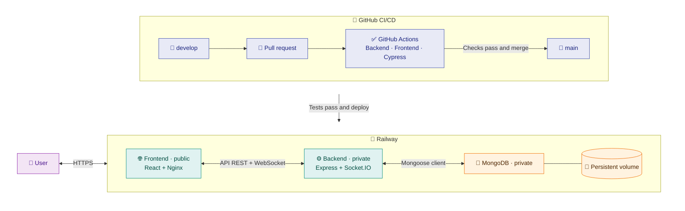

<div align="center">

# 📅 [OfficeTrackr](https://office-trackr.up.railway.app/)

**A simpler way for hybrid teams to plan their office days.**

[](https://react.dev/)
[](https://vite.dev/)
[](https://www.nginx.com/)
[](https://nodejs.org/)
[](https://expressjs.com/)
[](https://www.mongodb.com/)
[](https://www.docker.com/)
[](https://office-trackr.up.railway.app/)
[](./LICENSE)

**[🌐 Open OfficeTrackr](https://office-trackr.up.railway.app/)**

[The story](#-the-story) · [Key features](#-key-features) · [How I built it](#️-how-i-built-it) ·
[Architecture](#️-architecture) · [Next steps](#-next-steps) · [Getting started](#-getting-started) ·
[CI/CD](#-cicd) · [License](#-license)

</div>

## 📖 The story

While working in a hybrid team with two weekly office days, I created a spreadsheet to coordinate attendance and
shared it with my team and others. It worked well, but updating it and monitoring attendance became cumbersome.

I built OfficeTrackr to improve that experience and take ownership of a simulated product lifecycle, from design and
development to infrastructure, deployment and presenting the finished product.

## ✨ Key features

- 🗓️ **Interactive calendar:** Plan office days and vacations for the current or upcoming weeks.
- 🔐 **Roles:**
  - 👤 **Coworker:** Manage personal calendar events and track attendance.
  - 👔 **Manager:** Organize a team and review its office and vacation days.
  - ⚙️ **Admin:** Manage users, roles and teams.
- 📈 **Attendance tracking:** The monthly office-day target is 40% of weekdays excluding vacation, rounded to a whole
  day. Unmarked available weekdays count as telework.
- 🔑 **Authentication:** JWT-based authentication with bcrypt password hashing.
- 📊 **Manager dashboard:** See team office attendance and vacation days at a glance.
- 🌍 **Adaptable interface:** Use the app on different screen sizes, switch languages, and choose a light or dark theme.
- ⚡ **REST API:** Connect the React frontend to an Express backend and MongoDB.
- 🐳 **Docker-ready:** Run the frontend, backend and database locally with Docker Compose.

## 🛠️ How I built it

I used this project to explore three challenges:

1. 🎨 **Frontend experience:** I used React, Material UI and i18next to build a responsive interface with multiple
   languages and light/dark themes while developing my UI skills.
2. 🔑 **Authentication and authorization:** I used Express middleware and JWTs for authentication and role-based
   actions, with bcrypt for password hashing.
3. 🚀 **From local to live:** I orchestrated the local stack with Docker Compose, added GitHub Actions checks, and
   deployed the application to Railway.

## 🏗️ Architecture



## 🔭 Next steps

- **Make attendance targets configurable:** Let teams set their monthly office-day goals instead of using the current fixed
  40% of eligible weekdays.
- **Coordinate shared office days:** Give teams a clearer view of planned attendance so coworkers can choose days to meet
  in person and managers can spot gaps.
- **Connect external calendars:** Sync office days and vacations with Google Calendar or Outlook to keep plans visible
  alongside other commitments.

## 📁 Project structure

```text
office-trackr/
├── 📂 frontend/             # React UI, Nginx proxy and tests
├── 📂 backend/              # Express API, data model and tests
├── 📂 docs/                 # Local development guide
├── 📂 .github/workflows/    # CI checks
├── 📄 docker-compose.yml    # Local stack
├── 📄 mongo-init.js         # Local demo data
└── 📄 LICENSE               # GNU AGPL version 3
```

## 🚀 Getting started

Clone the repository and choose how to run it locally:

```bash
git clone https://github.com/patriciorr/office-trackr.git
cd office-trackr
```

**🐳 With Docker Compose:**

```bash
npm --prefix backend ci
docker compose up -d --build
```

Open [localhost](http://localhost). For a setup **without Docker**, configure a local MongoDB instance and run the
backend and frontend development servers. See the [local development guide](./docs/local-development.md) for both
options, prerequisites, local demo accounts and tests.

## 🧪 CI/CD

Changes move from `develop` to `main` through a pull request. Backend, frontend and Cypress checks must pass before
merging; Railway then deploys `main` after its CI checks.

## 📜 License

Copyright © 2026 Patricio Rodríguez Ramírez. Licensed under the
[GNU Affero General Public License v3.0 only](./LICENSE).
